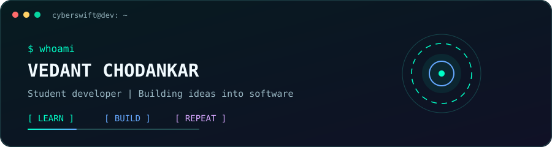
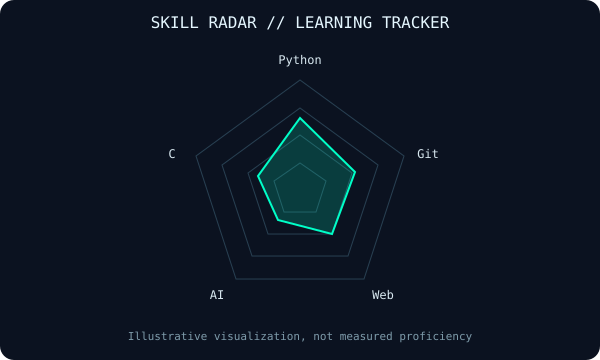

<div align="center">

# `> VEDANT CHODANKAR_`

### Developer · Builder · Problem Solver

[](https://github.com/Cyberswiftgit)

*Building projects, learning by shipping, and turning ideas into working software.*



</div>

---

## `~/about`

```text
USER       : Vedant Chodankar
HANDLE     : Cyberswiftgit
FOCUS      : Software development, AI, and web projects
PHILOSOPHY : Learn. Build. Test. Improve. Repeat.
```

I'm a student developer exploring software engineering, AI, and creative technology. I enjoy turning ideas into practical projects and learning how things work by building them.

## `~/toolbox`


<p align="center">
  
</p>

## `~/selected-work`

### A.R.I.A. — Desktop AI Assistant
A Windows assistant project exploring AI conversations, voice interaction, and a futuristic desktop interface.

### WeatherGPT — Weather Intelligence
A conversational weather project concept focused on explaining forecasts, alerts, and climate information.

### Aim Trainer — FPS Practice
A web-based aim training project exploring target practice, crosshair customization, and performance feedback.

> These are project descriptions, not claims that every feature is complete. Add the actual repository links as you publish each project.

## `~/github`

<p align="center">
  
</p>

<p align="center">
  
</p>

## `~/contributions`

<p align="center">
  
</p>

---

<div align="center">

`01100010 01110101 01101001 01101100 01100100`

**Thanks for visiting. More projects in progress.**

[GitHub](https://github.com/Cyberswiftgit)

</div>
